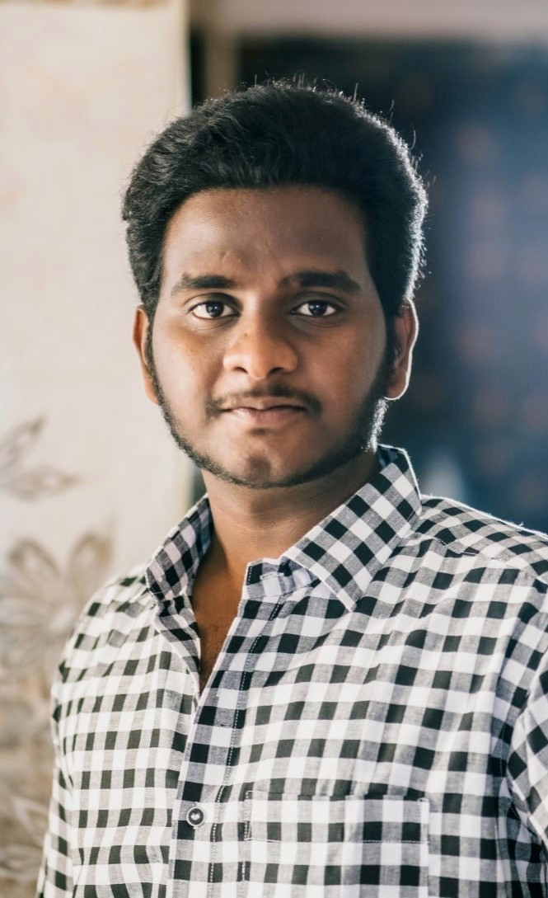

# Bino Mariyan - Personal Portfolio Website

An ultra-modern, high-impact personal portfolio website showcasing **Bino Mariyan's** expertise in AI/ML engineering, Full-Stack development, Multi-Agent Systems, RAG architectures, and Cloud platforms.

---

## 🌟 Highlights & Features

- **Cyber-Nebula Dark Theme**: Deep obsidian background with ambient glowing particle canvas, cyber cyan and electric violet gradient accents.
- **Glassmorphism Design**: Frosted glass cards, glowing borders on hover, and smooth micro-animations.
- **Flagship Project Showcases**:
  - *Food-Processing-Operations-Platform-V2* (FastAPI, Multi-Agent Systems, RAG, HACCP/ISO 22000 compliance audits) with interactive architecture modal.
  - *Hybrid XGBoost + LSTM Model* for personalized antihypertensive clinical decision support.
  - *Raspberry Pi Infrared Imaging (NDT)* with FLIR Lepton thermography for aerospace defect detection.
- **3D Responsive Interactive Portrait**: A futuristic glassmorphic 3D profile card with real-time mouse-tracking parallax tilt, dynamic specular glare, and floating 3D tech badges.
- **Interactive Project Filtering**: Instant categorization (`All`, `AI & Multi-Agent`, `SaaS & Full-Stack`, `Edge AI & Hardware`).
- **Interactive Resume Modal & PDF Print Mode**: Preview your complete verified resume with a dedicated "Print / Save PDF" feature styled for ATS standards.
- **Direct Contact & Clipboard Copy**: One-click email and phone copying with toast notifications.
- **100% Zero Dependencies**: Built with pure HTML5, Vanilla CSS3, and JavaScript — no build steps or heavy node modules needed.

---

## 🖼️ How to Use Your Own Photo

The website currently uses a sleek, cyber-styled professional avatar at [`assets/bino-portrait.svg`](assets/bino-portrait.svg).
To use your real photograph:
1. Save your photo as `profile.jpg` or `profile.png` inside the [`assets/`](assets/) folder.
2. Open [`index.html`](index.html) and update line 133:
   ```html
   
   ```
The 3D mouse parallax tilt, glowing aura, and floating badges will automatically apply to your photo!

---

## 🚀 How to Run Locally

You can run this website directly without any setup:

### Option 1: Direct File Open
Simply double-click [`index.html`](index.html) to open it in your default web browser (Chrome, Edge, Firefox, Brave, Safari).

### Option 2: Local HTTP Server (Python)
If you have Python installed, run:
```bash
python -m http.server 8000
```
Then visit [http://localhost:8000](http://localhost:8000) in your browser.

### Option 3: Node / NPX
```bash
npx serve .
```

---

## 📁 Project Structure

```
myportfolio/
├── index.html            # Semantic HTML5 markup, SEO meta tags, resume modal
├── styles.css            # Complete design system, glassmorphism, responsive & print styles
├── script.js             # Canvas particle animations, 3D tilt, filters, modals, clipboard toast
├── assets/               # Profile images and icons
│   └── bino-portrait.svg # Professional 3D developer portrait
└── README.md             # Documentation and deployment guide
```

---

## 🌐 Free 1-Click Deployment

### Deploy to GitHub Pages:
1. Push this folder to a GitHub repository (e.g. `bino-mariyan.github.io`).
2. Go to **Repository Settings** > **Pages**.
3. Under **Branch**, select `main` (or `master`) and folder `/ (root)`.
4. Click **Save** — your site will be live within seconds!

### Deploy to Vercel:
1. Install Vercel CLI (`npm i -g vercel`) or visit [vercel.com](https://vercel.com).
2. Run `vercel` inside this directory and select default settings.
